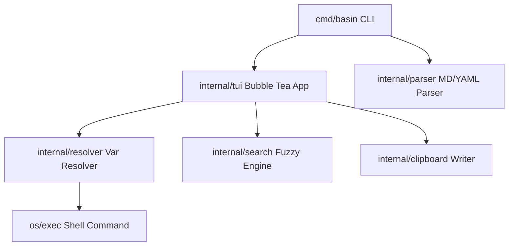

# Basin: Development Plan

This document outlines the design, architecture, implementation roadmap, and testing strategy for `Basin`, a Go-based interactive terminal strand manager.

---

## 1. Core Architecture & Modules

The application will be structured as modular packages in Go to isolate responsibilities and make testing straightforward.



### Module Descriptions:
1. **`internal/domain`**: Holds the fundamental data types.
   - `Snippet`: Name, description, raw body block, file location, and list of placeholders.
   - `SnippetFile`: File path, metadata tags, and slice of parsed strands.
   - `VariableSpec`: Configuration rules (default, suggestions list, suggestion command).
2. **`internal/parser`**: Parses Markdown files and handles frontmatter.
   - Scans markdown for `##` headers to split strands.
   - Reads YAML frontmatter (metadata name, tags, variables config).
   - Extracts placeholders (`<@name>`, `<@name:?default>`, `<@name:cmd>`) from the first non-`text` code fence.
3. **`internal/config`**: Reads and manages local configurations.
   - Loads `~/.config/basin/config.toml` (overridable with environment variables).
   - Resolves global variables, timeouts, custom paths, and formatting styles.
4. **`internal/resolver`**: Resolves placeholder values and evaluates dynamic inputs.
   - Merges inline specs, file-local frontmatter, and global config.
   - Executes suggestion commands in `bash -c` with context-bounded timeouts.
   - Supports dependent variables (`<#upstream>` / `<#upstream:raw>`) by updating and re-evaluating downstream variable commands dynamically as user input is confirmed.
5. **`internal/search`**: Implements search and navigation.
   - Fuzzy finding over titles, content, tags, and bodies.
   - Structured file tree navigation.
   - Tag listing dashboard.
6. **`internal/tui`**: The Interactive Interface (using Charm Bubble Tea).
   - State machine containing:
     - **Finder View**: Input box and listing for fuzzy searching.
     - **Browser View**: Hierarchical folder directory listing.
     - **Tags View**: Filtering strands by metadata tag.
     - **Wizard View**: Sequence of pages to prompt for missing variables, showing a selection list for suggestions (with command evaluation status) and standard input box.
   - Mouse navigation support for clicking list items and scrolling previews.
   - External editor support via `Ctrl+E` to open source markdown files.
7. **`internal/clipboard`**: Writes text to the clipboard cross-platform.
   - Uses `github.com/atotto/clipboard` in Go.

---

## 2. Key Libraries & Dependencies

| Purpose | Library | Reason / Role |
| :--- | :--- | :--- |
| **CLI Argument Parsing** | `github.com/spf13/cobra` | High-quality standard CLI utility for commands and completions. |
| **TUI Runtime Engine** | `github.com/charmbracelet/bubbletea` | Best-in-class Elm-architecture framework for Go terminal apps. |
| **TUI Inputs & Lists** | `github.com/charmbracelet/bubbles` | Standard components (`textinput`, `list`, `viewport`, `key`) to build views. |
| **TUI Layout & Styles** | `github.com/charmbracelet/lipgloss` | Declarative terminal layout and text styling library. |
| **Markdown Rendering** | `github.com/charmbracelet/glamour` | Terminal markdown renderer with customizable styles for code blocks. |
| **Fuzzy Matching** | `github.com/sahilm/fuzzy` | Quick, efficient fuzzy match engine for Go slices. |
| **YAML Frontmatter** | `gopkg.in/yaml.v3` | Parsing YAML frontmatter blocks inside Markdown files. |
| **TOML Config File** | `github.com/pelletier/go-toml/v2` | Fast, compliant parser for `config.toml` configuration files. |
| **Clipboard Copy** | `github.com/atotto/clipboard` | Direct clipboard access across Windows, macOS, and Linux. |
| **TUI Integration Test**| `github.com/charmbracelet/x/exp/teatest` | Simulation harness for verifying Bubble Tea models, keys, and views. |

---

## 3. Step-by-Step Implementation Phases

```
┌───────────────────────────────────────────────────────────────┐
│ Phase 1: Setup & Boilerplate (cli flags, config reader)       │
├───────────────────────────────────────────────────────────────┤
│ Phase 2: MD & YAML Parser (strand and frontmatter parsing)    │
├───────────────────────────────────────────────────────────────┤
│ Phase 3: Variable Resolution Engine (suggestions, dependency) │
├───────────────────────────────────────────────────────────────┤
│ Phase 4: Core TUI Navigation (fuzzy find list, file tree, tags)│
├───────────────────────────────────────────────────────────────┤
│ Phase 5: TUI Wizard Component (sequential variable prompts)  │
├───────────────────────────────────────────────────────────────┤
│ Phase 6: Clipboard Integration & Commands                    │
├───────────────────────────────────────────────────────────────┤
│ Phase 7: Complete Testing (unit tests and teatest integration)│
└───────────────────────────────────────────────────────────────┘
```

### Phase 1: Setup & Skeleton CLI
- Initialize `go mod init basin` in the workspace directory.
- Create basic directory layout matching the repository layout.
- Build the `basin` CLI command skeleton (`cmd/basin/main.go` using Cobra).
- Implement config file parser (`internal/config`) to parse TOML configurations.

### Phase 2: Markdown & Frontmatter Parser
- Write parser logic that reads a Markdown strand file.
- Scan for `##` sections. Identify description block and code fences.
- Extract YAML frontmatter at the top of the file using `gopkg.in/yaml.v3`.
- Parse placeholders inside the code block matching regex `<@([a-zA-Z0-9_-]+)(:(\?.+|[^>]+))?>` to extract variables and their inline sources.
- Exclude `text` fenced code blocks from executable strands, using them only as preview content.
- Verify with unit tests.

### Phase 3: Variable & Template Resolver
- Establish priority resolution (Inline -> Frontmatter -> Config -> Built-in suggestions).
- Implement built-in directory/file suggestions using `os.ReadDir` in the current working directory.
- Build runner to execute suggestion commands using `exec.CommandContext` with a configurable timeout.
- Implement dependent variables processor:
  - Parse `<#name>` (shell-escaped) and `<#name:raw>` (literal splice) inside command suggestions.
  - Assert that references point to variables ordered prior to the current variable (prevent cyclic/forward dependencies).
- Verify template interpolation with tests.

### Phase 4: TUI Selection Modes
- Build main Bubble Tea application model.
- **Fuzzy Finder**: Displays all parsed strands. Pressing `ctrl+t` toggles active view.
- **Browser**: Shows strands in a hierarchical list corresponding to folders and files.
- **Tags View**: Groups strands by their tags and counts them. Allows selection of a tag to filter.
- Support Helix-style operator searches in fuzzy finder (`tag:docker`, `path:...`, `name:...`, `snippet:`).
- Mouse navigation: click to select items, scroll wheel to navigate lists and previews.

### Phase 5: TUI Variable Fill-in Wizard
- If the selected strand requires variables, transition the TUI to the **Wizard view**.
- The Wizard maintains an input stack of placeholders.
- For each placeholder:
  - Render placeholder name and description.
  - Display suggestion list (static list, files/dirs list, or stdout from executed commands).
  - Support list filtering and selection using keyboard arrow keys.
  - Allow typing custom text inside a `textinput` component.
  - Support multi-line input insertion via **Alt+Enter** (or paste).
  - Pressing `Enter` or `Tab` locks the value, re-evaluates dependent variables downstream, and advances.
  - Pressing `Shift+Tab` navigates backward to correct previous inputs.
- When all variables are filled, compile the final rendered template and transition to Clipboard Copy.

### Phase 6: Clipboard Integration & Commands
- Copy final content to system clipboard using `github.com/atotto/clipboard`.
- Output selected strand to stdout for capturing by shell buffers.
- Support terminal raw-mode restore on exits.
- External editor support: `Ctrl+E` opens the source markdown file in the system's default editor (`$VISUAL`, `$EDITOR`, or platform default). On editor exit, the TUI resumes with previous selection retained.

### Phase 7: Verification & Testing
- Write comprehensive unit tests for parser, resolver, config, and domain modules.
- Create TUI integration tests using `teatest` (details below).

---

## 4. Testing & Integration Strategy

### Unit Testing Guidelines
- Use the standard `testing` package with simple comparison checks.
- Keep tests completely isolated; avoid modifying actual user files or reading production config directories. Mock all filesystem and command invocations.

### TUI Integration Testing (Visible & Navigable)
To satisfy the requirement that "the TUI must be integration tested to ensure tui elements are visible and it is navigable," we will write tests using `github.com/charmbracelet/x/exp/teatest` or program inputs.

#### teatest Example Harness:
```go
package tui_test

import (
	"strings"
	"testing"
	"time"

	"github.com/charmbracelet/bubbletea"
	"github.com/charmbracelet/x/exp/teatest"
	"basin/internal/domain"
	"basin/internal/tui"
)

func TestTUI_FuzzyFinderNavigation(t *testing.T) {
	strands := []domain.Snippet{
		{Name: "List directory contents", Body: "ls -la"},
		{Name: "Check disk usage", Body: "df -h"},
	}

	m := tui.NewAppModel(config.DefaultConfig(), strands, nil)
	tm := teatest.NewTestModel(t, m, teatest.WithWidth(80), teatest.WithHeight(24))

	tm.Send(tea.KeyMsg{Type: tea.KeyDown})
	
	time.Sleep(100 * time.Millisecond)
	out, err := tm.Output()
	if err != nil {
		t.Fatalf("failed to read output buffer: %v", err)
	}

	if !strings.Contains(string(out), "Check disk usage") {
		t.Errorf("expected 'Check disk usage' to be visible, got: %s", string(out))
	}

	tm.Send(tea.KeyMsg{Type: tea.KeyEsc})
	tm.WaitFinished(t, 2*time.Second)
}
```
